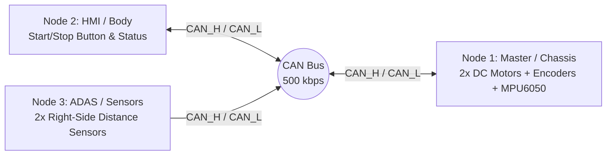
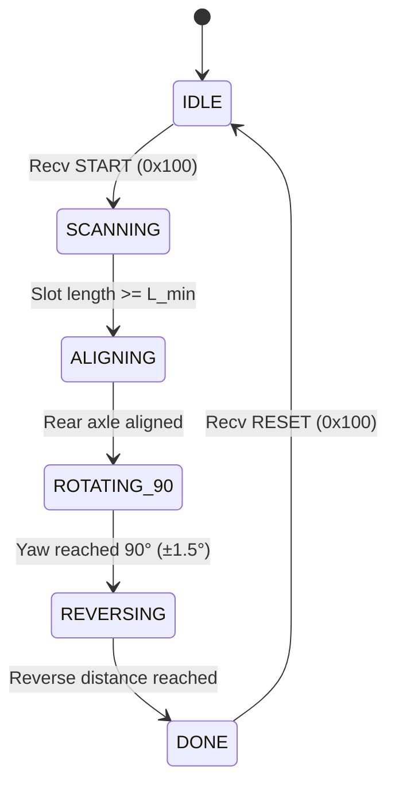

# CAN_Automotive_FPT

A 3-node distributed **CAN bus** autonomous reverse-parking robot system. The project demonstrates real-time inter-node communication, sensor fusion, and automated parking slot detection & maneuvering.

---

## 1. System Architecture

The system follows an automotive-inspired distributed architecture over a standard **500 kbps CAN bus** (with $120\,\Omega$ termination resistors at both ends):

### Node Responsibilities
* **Node 1 (Powertrain & Master FSM):** Runs the main autonomous parking state machine, controls the 2 differential-drive motors, reads wheel encoders for odometry, and uses the **MPU6050** IMU for yaw angle tracking.
* **Node 2 (HMI Controller):** Reads physical push-buttons (`START`, `E-STOP`, `RESET`) to trigger parking maneuvers and displays system status feedback from Node 1.
* **Node 3 (Parking Sensor Module):** Reads two right-side distance sensors using time-division multiplexing (to prevent crosstalk) and median filtering, then broadcasts filtered distance measurements onto the CAN bus.

---

## 2. CAN Communication Matrix

| CAN ID | Direction | Cycle Time | DLC | Payload Layout & Description |
| :--- | :--- | :---: | :---: | :--- |
| **`0x100`** | Node 2 $\rightarrow$ Node 1 | On Event + 100 ms | 2 | **Byte 0:** Command (`0x00`: E-Stop, `0x01`: Start, `0x02`: Reset) **Byte 1:** Rolling Counter (`0–255`) |
| **`0x200`** | Node 3 $\rightarrow$ Node 1 | 50 ms (20 Hz) | 5 | **Byte 0–1:** Front-right distance (`uint16`, mm) **Byte 2–3:** Rear-right distance (`uint16`, mm) **Byte 4:** Sensor status / validity flags |
| **`0x300`** | Node 1 $\rightarrow$ Node 2 | 100 ms (10 Hz) | 4 | **Byte 0:** Current FSM State (`IDLE`, `SCAN`, `ALIGN`, `ROTATE`, `REVERSE`, `DONE`, `ERROR`) **Byte 1–2:** Current Yaw Angle (`int16`, deg $\times$ 10) **Byte 3:** Error code |

---

## 3. Autonomous Parking Algorithm (FSM)

1. **`IDLE`**: Motors stopped, waiting for `START` command (`0x100`) from Node 2. Calibrates MPU6050 Z-axis gyro offset.
2. **`SCANNING`**: Drives straight at low speed while monitoring right-side distance data (`0x200`). Records encoder distance when an empty slot is detected until $L \ge L_{\text{required}}$.
3. **`ALIGNING`**: Moves forward a fixed offset distance (via encoders) to align the rear axle with
